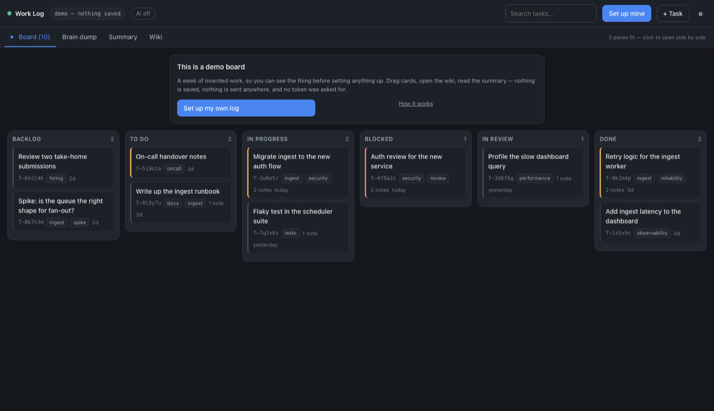
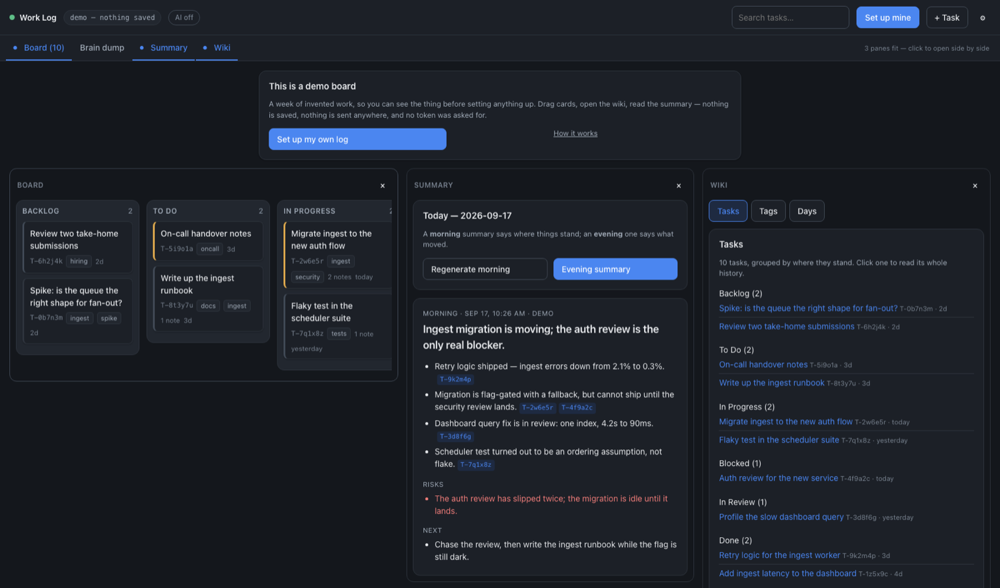
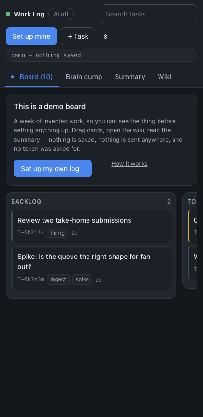

# Work Log

A JIRA-style Kanban board for your own work that writes a **stateful, human-readable ledger of it
behind the scenes** — as markdown *and* JSON, in a git repo that is entirely yours, private or
public as you choose.

**[Try the demo](https://tanmayagrawal21.github.io/worklog/?demo=1)** — sample data, no token, nothing
saved. **[Live app](https://tanmayagrawal21.github.io/worklog/)** when you want your own.

You use it the way you'd use any tracker: drag cards between columns, add notes, change status,
close things out. What you get *for free* is the artifact that normally doesn't exist — a legible
record of what you actually did, accumulating in your own repo, which you publish when you feel like
it rather than on every keystroke. Nothing reaches GitHub until you approve the commit, and you see
its message and file list first.

Optionally, connect any model — running locally on your machine, Hugging Face inference,
OpenAI, Anthropic, Google, or any OpenAI-compatible endpoint — and you get two more things:

- **Brain dump.** Type everything you've been doing, however it comes out. It proposes board
  updates — new items, notes, status changes — and **every proposal has a checkbox**. Nothing is
  applied until you tick it, so the AI drafts and you decide.
- **Executive summaries.** A morning read of where things stand, an evening read of what moved,
  written into the log next to the work they describe.

No build step, no server, no database, no dependencies — plain ES modules served straight off GitHub
Pages. The one exception is the in-browser WebGPU tier, which fetches the WebLLM runtime from a CDN
the first time you use it.



The views are panes, not tabs: on a wide screen you open the board, the summary and the wiki beside
each other, which is what the daily loop actually wants. A layout is shareable — `?panes=board,summary,wiki`
is the link that produced this.



Down to about 400px it stays usable: the header wraps, panes collapse to one, and the columns scroll
sideways.



## The daily loop

Setup is two things — a repo to keep your log in and a GitHub token so the app can write to it —
and [SETUP.md](SETUP.md) walks both in about two minutes. The [demo board](https://tanmayagrawal21.github.io/worklog/?demo=1)
is there if you want to see the loop running first; it is the same code over invented data, with a
built-in interpreter standing in for the model, so the brain dump and the summary work there too.

1. Open the app. Read the morning summary of where things stand.
2. Either **drag cards** on the board, or **brain-dump a paragraph** and let the AI propose
   changes — every proposal comes with a checkbox, and nothing is applied until you check it.
3. At end of day, brain-dump again and take the evening summary.
4. Open **Standup** and copy the sign-off report for your team.
5. Hit **Publish**. You see the exact commit message and file list *before* anything is pushed.

Staging is local, which is the point — but it does mean unpublished work lives in one browser and
nowhere else. So the header carries a count of what is unpublished that you can *click* to read the
list, closing the tab with staged changes asks first, and an end-of-day reminder (17:30 local by
default, one click to turn off, in Settings to change) speaks up if something is unpushed, the
evening summary is missing, or — once you have started sending them — today's sign-off report has
not gone out.

Alongside the board there's a **wiki** view: one page per task with its whole history, pages per
tag, and a dated journal page per day. Task ids written in notes (`blocked by T-4f9a2c`, or
`[[T-4f9a2c]]`) become real links, so notes accumulate into a connected record.

## The report you owe your team

Most teams want a line in a channel at the end of the day. The **Standup** pane writes it from your
log rather than from memory, which is the hard part at 6pm:

```text
Signing off:

ingest
Dead-letter queue drained. Nothing stuck since the backoff change
Fallback path reviewed; ready to flip the flag the moment the auth review lands

tests
Injected the clock instead of sleeping on it. Green under --repeat 200
```

**The line is your note, not the task title.** A note is already the sentence these reports are made
of — "Injected the clock instead of sleeping on it" is what you did, while "Flaky test in the
scheduler suite" is a backlog entry. The title is the fallback for work you moved without writing
anything down. One line per task, however many times you touched it.

**No status vocabulary.** No `Done:`, no `In progress:`, no `Blocked:` — not as headings and not as
markers on a line. Nobody writes their day that way; a channel wants the work, and anything worth
flagging you will say in your own words. Grouping is your first tag or one flat list, with a
markdown switch for `##` headings and `-` bullets where markdown renders.

**Write it up** hands those lines to a model to phrase the way a colleague would — verb-first, with
the outcome folded in. It is [multi-shot](js/ai.js): a described style does not survive contact with
a model the way a demonstrated one does, so four example pairs carry the shape. The model returns
grouped lines and nothing else — layout, the first line and your edits are never its to decide — and
its answer is clamped: no more lines than there were pieces of work, so a model that starts
narrating cannot invent a workstream, with bullets, status labels and task ids stripped back out.
Press it after editing and your text goes too, to be kept and tidied rather than thrown away — and
your own lines raise that cap, because then your text is the authority on what belongs in there.

Three more things worth knowing:

- **It works with AI switched off.** The draft above is computed from the event log. The write-up is
  an extra, not the path.
- **Your internal task ids never appear**, in the text or in the prompt. `T-4f9a2c` means nothing to
  anyone else in the channel. The summary pane uses ids because it is written for you; this one is
  not. Tasks marked private are excluded, and note text can be withheld from the model in Settings.
- **Copying records it**, as the text you actually copied — edits and all. A report you sent is a
  fact about the day, so it lands in the repo beside the work, and the end-of-day reminder stops
  asking once it has gone out.

## AI is a choice, and "none" is one of them

Pick a tier in Settings. The default is the first one — until you choose otherwise, your log goes
to your own repo and nowhere else.

| Tier | What runs | What leaves your machine |
| --- | --- | --- |
| **No AI** | nothing | nothing — it's a board and a changelog |
| **On my machine** | WebLLM on your GPU in this browser, or Ollama / llama.cpp / LM Studio locally | nothing |
| **Open models in the cloud** | Hugging Face inference | task titles (see below) |
| **A commercial or custom API** | OpenAI, Anthropic, Google, OpenRouter, or any OpenAI-compatible endpoint | task titles (see below) |

For the two cloud tiers: any task you flag **private** is never included in a request, and a
global *"titles only, never notes"* toggle withholds note text from every request. The brain-dump
box is the exception, and it is one worth knowing about — it is free text, so nothing can filter it
on your behalf. Before the **first** request to any cloud provider the app shows you what is about
to leave: the URL, the model, how many tasks and notes, how many private tasks were held back, and
your update verbatim. You can say no, and changing provider or endpoint URL asks again.

Requests negotiate down through `json_schema` → `json_object` → plain prompting, and drop sampling
parameters an endpoint rejects, so gateways with narrow parameter support still work.

## Privacy model

- **Your data repo can be private.** Confidentiality is GitHub's repo visibility setting, enforced
  server-side — not client-side encryption. The app reads and writes it with *your* token.
- **This app repo is public and holds no data.** Pages on a Free plan cannot serve a private repo,
  so the app is public; nothing of yours is in it.
- **Tokens never leave your browser.** They live in `localStorage`, never in any commit, and are
  locked behind a passphrase by default (PBKDF2-SHA256, 600k iterations → AES-GCM) — one prompt per
  load, and you can untick it on a machine only you use. AI keys are stored per provider.
- **You approve every push.** No write to your repo happens without the preview dialog first.

Caveats worth reading before you trust it with anything sensitive:

1. Task JSON is **plain text** in your repo. That is deliberate — it's what makes `git diff`
   readable — but a private repo later flipped to public exposes its entire history.
2. On the cloud tiers, board content reaches a third-party inference provider. The `private` flag
   and the notes toggle are the mitigations, and they are in Settings, not buried — but they filter
   the *board*, not the brain-dump box, which is why that first request is shown to you in full.
3. The passphrase lock uses PBKDF2 rather than Argon2id because that is what WebCrypto offers. The
   iteration count is stored with the record so it can be raised later.

## Getting started

Use the hosted app and point it at your own repo — see [SETUP.md](SETUP.md). If you don't have a
data repo yet, the first-run wizard offers to create one and asks whether it should be public or
private.

## Deploy your own copy

Nothing here is tied to my account: the app reads its own URL at runtime and every asset path is
relative, so a copy works unchanged wherever it is served from.

1. **Use this template** (or fork it) into a repo of your own.
2. Settings → Pages → Source: *Deploy from a branch*, `main`, `/ (root)`.
3. Wait for the first build; your copy is at `https://<you>.github.io/<repo>/`.

That's it — no configuration step, no secrets, no Actions. Your copy writes *its own* URL into the
data repos it sets up, and `scripts/setup.sh` picks the URL up from the git remote for the same
reason. Worth doing if you'd rather your team not depend on a Pages site under someone else's
account, and it's the only option if you want to pin a version.

The app repo has to be public for Pages to serve it on a Free plan. That costs nothing in privacy:
it contains no data and no tokens, and your log lives in a separate repo that can be private.

## Running it locally

There is nothing to install and nothing to build.

```sh
git clone https://github.com/tanmayagrawal21/worklog.git
cd worklog
python3 -m http.server 8000
# open http://localhost:8000
```

It must be served over HTTP rather than opened as a `file://` URL, because it loads ES modules.
Any static server does — `caddy file-server`, `npx serve`, whatever you have.

If you have Node and would rather not clone anything, the app also runs as one npm command:

```sh
npx work-log          # serves it and opens a browser
npx work-log --demo   # the sample board, no token, nothing saved
```

*Not on npm yet — the package is here and works, but the first `npm publish` has not happened. From
a checkout, `node bin/worklog.mjs` is the same thing. Delete this note once it is published.*

That is a static file server over the package's own directory and nothing else — no build, no
dependencies, no telemetry, nothing written outside your data repo. `npx work-log --help` lists the
handful of flags (`--port`, `--host`, `--no-open`). Useful if you want a pinned version, or if your
laptop is where you'd rather the AI keys live; note that a browser will not reach a `localhost`
inference server *from* a `https://` page, so the local-model tier is easier this way round.

## How your data repo is laid out

Written so that it reads well on GitHub with no tooling at all: every JSON file has a rendered
`.md` sibling, and clicking any `.md` on GitHub renders it — private repos included.

```
data/manifest.json        which months exist, counts, schema version
data/board.json           snapshot of the current board + `through` marker
data/BOARD.md             the same board, rendered
data/log/README.md        index of the whole log
data/log/2026/README.md   index of that year
data/log/2026/09/…        one month of events: 09.json + 09.md
CHANGELOG.md              small index, not a growing wall of text
```

Two design decisions carry the weight. The event log is the source of truth — the board is
`fold(events)`, and merging two machines is a **union by event id** re-sorted by `(ts, id)`, so it's
order-independent and idempotent. And events and snapshot tasks serialise **one record per line**,
so one change is one added line in `git log -p`, and files stay under GitHub's 20,000-line diff
limit for decades. Boot reads the manifest, the snapshot, and about three months — not every month
you have ever logged, so year five opens as fast as week one.

**Dates are yours, timestamps are UTC.** Every event stores a UTC instant, because that is the only
thing two machines agree on and the only thing that sorts. But the day a piece of work belongs to is
your local one: day headings, month filing and the times in the rendered pages are all local, and
each month page says which offset it was generated in. Otherwise an evening in Tucson lands on
tomorrow, which is where this started.

Repos written by the earlier flat layout still load, and the app offers a one-commit upgrade
(behind the same preview-and-confirm gate as any other push).

New kinds of entry arrive as new event **types**, not new files — a summary (`summary.set`) and a
sign-off report (`standup.set`) are both just lines in the month they happened in, carrying a
`date` and a `kind` instead of a `taskId`. Nothing about the layout above changes, the schema
version does not move, and `fold()` skips types it does not recognise, so a repo written by a newer
copy of the app still opens in an older one.

## Tests

```sh
./scripts/test.sh
```

251 assertions across store, ai, time, providers, rules, consent, reminder, dom, demo, github and
the two standup suites — one of which renders the pane against a
[fake DOM](test/fake-dom.js), because a view that throws on render is invisible to a test that
never runs the renderer. Plus 26 more that
exercise the CLI — run under JavaScriptCore, which ships with macOS, so there are no dev
dependencies either. Every suite is then re-run under `Pacific/Kiritimati` (UTC+14), `Pacific/Niue`
(UTC-11) and `UTC`, because a local-date bug only shows up on one side of the line. Any ES-module
runtime works: `JSC=$(which node) ./scripts/test.sh` needs `--experimental-vm-modules` on older Node.

## Where things are

| Path | Role |
| --- | --- |
| [js/store.js](js/store.js) | events, fold, union-merge, snapshot + markdown rendering, staging, push |
| [js/github.js](js/github.js) | contents + Git Data API, atomic multi-file commits, conflict detection |
| [js/ai.js](js/ai.js) | request negotiation, `proposeOperations`, `summarise`, `writeStandup` + its few-shot examples |
| [js/providers.js](js/providers.js) | the provider catalogue behind the four tiers |
| [js/vault.js](js/vault.js) | token storage and the passphrase lock |
| [js/reminder.js](js/reminder.js) | when the end-of-day nudge is due, as a pure function |
| [js/standup.js](js/standup.js) | the morning and sign-off reports: built from the log, rendered for a channel |
| [js/bootstrap.js](js/bootstrap.js) | inspecting a repo and scaffolding a new one |
| [js/ui/](js/ui/) | board, brain dump, summary, standup, wiki, settings, setup wizard, the cloud-disclosure gate, DOM helpers |
| [js/webllm.js](js/webllm.js) | the in-browser WebGPU path |
| [js/demo.js](js/demo.js) | the sample board behind `?demo=1`, read through the real Store |
| [js/rules.js](js/rules.js) | the demo's keyword interpreter: stands in for a model when no provider is set |
| [test/](test/) | headless suites and the JSC shim |
| [scripts/](scripts/) | the test runner, and the CLI path for seeding a data repo |
| [bin/worklog.mjs](bin/worklog.mjs) | the `npx work-log` static server: zero dependencies, ~150 lines |

Model output is treated as untrusted: `sanitiseOperations` drops hallucinated task ids, bad enums,
and no-op edits before anything reaches the board. All UI text goes through `textContent` — there is
no HTML string templating anywhere, so a note containing markup stays text.
