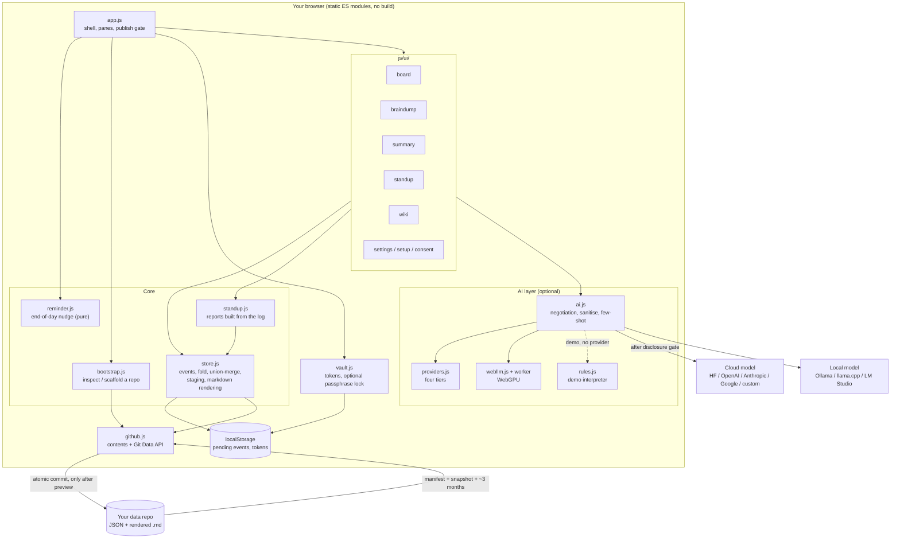
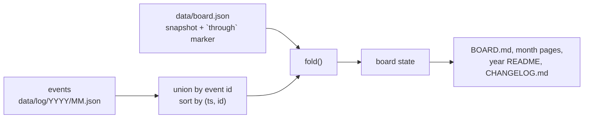
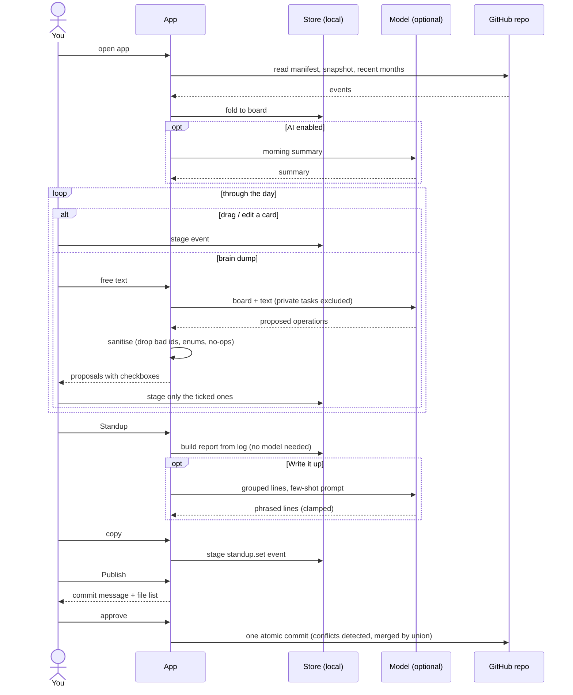
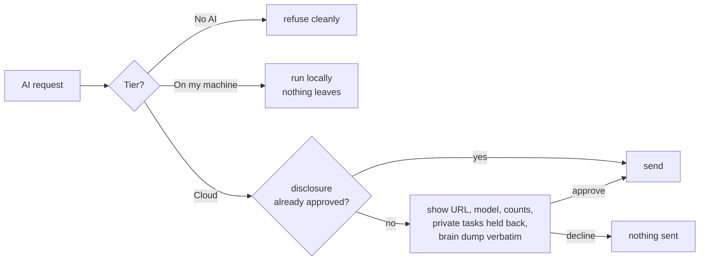

# Architecture and workflow

Diagrams are [Mermaid](https://mermaid.js.org/), which GitHub renders inline.

## Architecture

Everything runs in the browser. There is no backend: the only outbound calls are to GitHub (your
data repo) and, if you choose a tier that needs one, a model provider.

## Data model

The event log is the source of truth; the board is `fold(events)`.

## Daily workflow

Every edit stages locally. Nothing reaches GitHub until you approve the commit.

## Cloud disclosure gate

Applies only to the two cloud tiers, before the first request and again when the provider or
endpoint URL changes.

